<p align="center">
  
</p>

<h1 align="center">xray-pwc</h1>

<p align="center">
  <b>Probes that check your XRay VPN links from real networks, the way a person would.</b>
</p>

<p align="center">
  <a href="https://github.com/nikitades/xray-pwc/actions/workflows/ci.yml"></a>
  <a href="https://github.com/nikitades/xray-pwc/releases/latest"></a>
  <a href="https://github.com/nikitades/xray-pwc/pkgs/container/xray-pwc-aio"></a>
  
  
  
  <a href="LICENSE"></a>
  <a href="https://github.com/nikitades/xray-pwc/commits/main"></a>
  <a href="https://grafana.com/grafana/dashboards/25903/"></a>
</p>

## Killer feature

The setup is very simple. You just need to run a single docker container, that's it. It's called AIO, or all-in-one.



## About

xray-pwc shows whether your VPN configs (aka links) really work for people in a given
network, for example a home internet provider in one city. You put a small
machine, a *probe*, into that network. Every few minutes the probe opens real
websites through each of your VPN configs, the way a person would, and records how
far it got: everything opened, some sites opened, or nothing got through.

All probes send their results to one central server, which stores them and
draws them in Grafana. Probes need no public address and no open ports: each
one connects to the server by itself through a small private WireGuard
network, xray-pwc-net.

Remarkably, the Wireguard network is wrapped into the XRay tunnel! This means,
in environments where providers impose heavy DPI, technologies such as Wireguard and
at times even AmneziaWG don't work. But that's no issue here! XRay takes care of that.

A simple schema:

`probe <-> XRay tunnel <-> Wireguard <-> metrics collector`

The same network lets you reach the probes over SSH, from
the control plane machine (the one you run Ansible on) through the central
server. Where the provider blocks that connection, a probe carries it
through one of your VPN links instead (`outbound_access_policy: vpn`).

To make it clear, there are two lists of VPN configs:

- the list of configs to check
- the list of configs to use as a secure XRay tunnel

and these lists don't have to be the same. But they might.

A probe is one Docker container, so any machine with Docker can be one:
Linux, macOS or Windows. Its owner only starts it; from then on everything
goes through xray-pwc-net, from your own machine, with Ansible: no SSH to the
probe's host, ever. Inside the container nothing runs as root. The project
is young: treat the defaults as a starting point, not as tuned values. No root needed!

## Which part you need

The parts work on their own too. Take only what solves your problem:

| your problem | take |
|---|---|
| You want to know if an Xray link really works: real pages in a real browser, not a ping | [`xray-pwc-probe`](xray-pwc-probe/README.md), the checker. A Python wheel; run it on your machine with a links file, or in its Docker image. It gives a log line and Prometheus metrics per link |
| You need many Xray links as local ports at once, or one stable port that carries TCP and UDP through whichever of your links works now | [`xray-pwc-connect`](xray-pwc-connect/README.md). One Go binary, `go install ...@latest` or from a release: share links in, SOCKS ports or a self-healing forward out |
| You want a fleet of probes in different networks, watched from one Grafana | everything: [`xray-pwc-aio`](xray-pwc-aio/README.md), the probe as one container, and the [Ansible playbooks](ansible/README.md) that set up the server, join the probes and deliver the code |

## What runs on the central server

A Docker Compose project, `vpn-monitoring` in `/opt/vpn-monitoring`:

| service | what it does | listens on |
|---|---|---|
| `prometheus` | stores the results: probes push them (remote write), kept 180 days or 40 GB. It has no password, so it is not public | `127.0.0.1:9090` and `10.213.97.1:9090` (xray-pwc-net) |
| `grafana` | graphs, dashboards, alerts | `127.0.0.1:3000`, public through Caddy |
| `coredns` | names inside xray-pwc-net: `<host>.xray-pwc-net.internal` and `prom.xray-pwc-net.internal`; any other name goes to 1.1.1.1 and 8.8.8.8 | `10.213.97.1:53` |

On the host itself, outside Compose:

- **Caddy** (a system package): HTTPS for Grafana with a Let's Encrypt
  certificate. It is the only public web service.
- **`wg-quick@xray-pwc-net`**: the xray-pwc-net server (WireGuard, UDP `51973`).
  Docker starts after it, because Prometheus and CoreDNS listen on its
  address. Probes reach only this server, not each other.
- **sshd**, as the bastion: SSH to the probes goes through it (`ssh -J`).

## What runs on a probe

One container, `xray-pwc-aio`, started from one `compose.yml`. Inside, under
s6:

| service | what it does |
|---|---|
| `probe` | the checker. It opens the sites through each link with Chromium and xray-pwc-connect, and uses the probe's own network and DNS, so it sees what a local user sees |
| `alloy` | Grafana Alloy: every 30 s it collects the checker's results and the host's CPU, memory, disk and network, and sends them on. If the server is out of reach, it keeps up to 8 hours of data and sends it later |
| `relay` | only with `outbound_access_policy: relay`: a small Caddy between Alloy and Prometheus, a new connection for every small batch, for a probe where Alloy's one long connection keeps stalling. It hides nothing from the network: the data is inside the WireGuard tunnel either way |
| `wg` | the xray-pwc-net client, in the container's own network: the host gets no interface or route, and other VPNs on the machine keep working |
| `connect-forward` | only with `outbound_access_policy: vpn`: carries xray-pwc-net through one of the probe's service links, VPN links of its own, for providers that block UDP to the server. It checks every link all the time and moves to the next good one when the current one fails; with none good, it goes without a VPN |
| `sshd` | for Ansible and you, through the central server |

Every service runs as the unprivileged user `abc` and logs into one file,
`/app/logs/aio.log`, rotated weekly; on the host, `docker compose logs`
shows the same lines.

How the probe's own traffic leaves its network is one setting per probe,
`outbound_access_policy`:

| policy | xray-pwc-net | Alloy sends |
|---|---|---|
| `plain` (default) | straight to the server over UDP | over one connection, in big batches |
| `relay` | straight to the server over UDP | through the relay, a new connection per small batch |
| `vpn` | through the service links | over one connection, in big batches |

```
probe:  probe -> VPN link -> websites
        alloy [-> relay] -> xray-pwc-net [-> service link] -> server: prometheus -> grafana
```

## Versions and releases

One version for everything, in [`VERSION`](VERSION): xray-pwc-probe,
xray-pwc-connect, the bundle and the image of a release all carry it, and
only parts of the same version work together. The checker refuses an
xray-pwc-connect of another X.Y.Z, and Ansible a bundle the probe's image is
too old for.

A release is a tag: raise `VERSION`, merge, and push `vX.Y.Z`. CI
(`.github/workflows/release.yml`) tests everything, then publishes:

- the GitHub release `vX.Y.Z`: `xray-pwc-connect` for Linux and macOS, the
  `xray-pwc-probe` wheel, the bundles Ansible brings to the probes, and
  `SHA256SUMS`;
- the image `ghcr.io/nikitades/xray-pwc-aio:X.Y.Z` (also `X.Y` and
  `latest`), amd64 and arm64, built from the same wheel and binaries;
- the tag `xray-pwc-connect/vX.Y.Z`, so that
  `go install github.com/nikitades/xray-pwc/xray-pwc-connect/cmd/xray-pwc-connect@latest`
  (or `@vX.Y.Z`) installs it.

Everything else is a dev build, `X.Y.Z-dev.<hash>`, named by a hash of its
sources: `make bundle` here, or `xray_pwc_release: local` in Ansible to try
it on a probe before the release. The root [`Makefile`](Makefile) builds the
same way locally and in CI. MIT licensed, see [`LICENSE`](LICENSE).

## The dashboard

[](https://grafana.com/grafana/dashboards/25903/)

One page for the whole fleet, from the probes' metrics. The colours are the
check's stages: green is `3`, every page opened; yellow is `2`, traffic got
through but not every page opened; orange and red are `1` and `0`, nothing
got through ([the stages](xray-pwc-probe/README.md)).

- **VPN tunnels at hosts**: every link on every probe over time, one row per
  `link@probe`.
- **VPN online**: the stage of each link now.
- **Degraded tunnels** and **Degraded hosts**: only the links, and the probes,
  that fell below `2`. Empty means all is well.
- **VPN tunnels at hosts - errors**: why checks failed, by error type, link
  and probe.
- **Hosts CPU**, **Hosts mem**: the load of the machines the probes run on.
- **Probes network**: the probes' own traffic, in and out (the container's
  network, not the whole host's).

To install it, in Grafana:

1. **Connections → Data sources → Add → Prometheus**, URL
   `http://prometheus:9090` (the server's Compose network). Save.
2. **Dashboards → New → Import**, ID `25903`, **Load**, pick that data
   source, **Import**.

## Where to read more

- [`xray-pwc-probe/`](xray-pwc-probe/README.md), the checker: what one check
  does, how the result is counted, what it does not catch, the metrics and
  useful queries, the settings. Start here to try one link on your own
  machine.
- [`xray-pwc-connect/`](xray-pwc-connect/README.md), a small Go tool the
  checker uses: it turns share links into local ports, and carries the
  xray-pwc-net tunnel on probes with `outbound_access_policy: vpn`.
- [`xray-pwc-aio/`](xray-pwc-aio/README.md), the probe container: its
  services, its log, what is in the image and what Ansible brings.
- [`ansible/`](ansible/README.md), the deployment: the central server and
  the probes step by step, adding and removing probes, how xray-pwc-net works,
  where the secrets live.
